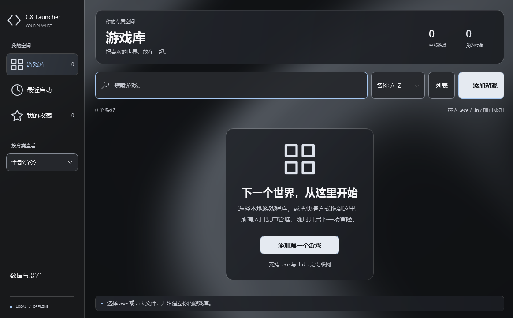
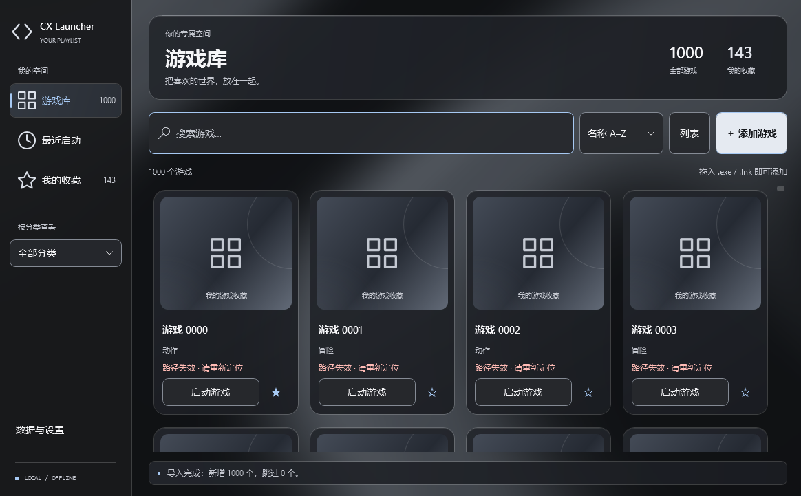
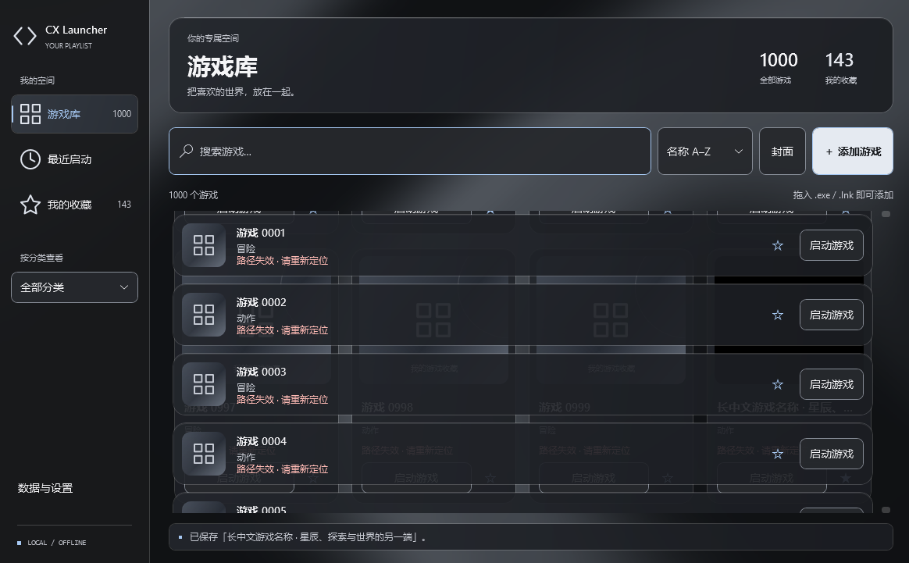
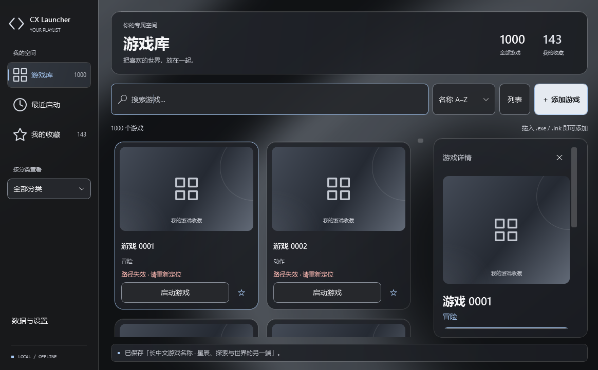
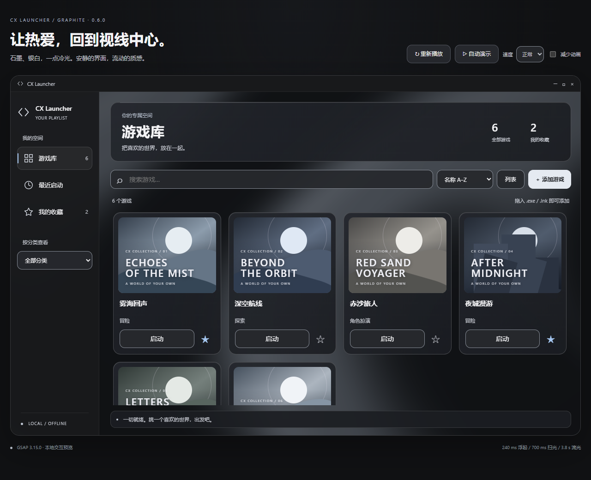

# CX Launcher

面向 Windows 的本地游戏启动器。在一个简洁的面板里整理游戏、快捷方式和封面，快速回到你的游戏世界。

当前版本：**0.6.0 · Graphite**。石墨黑、银白与少量冰蓝高光，搭配可响应鼠标的银灰流体背景和轻量玻璃面板。

[下载最新版本](https://github.com/ChineseCasey/CXLauncher/releases/latest) · [版本记录](https://github.com/ChineseCasey/CXLauncher/releases) · [实施与验证](docs/implementation-status.md)

## 运行效果



原生 WPF 界面，展示首次打开时的游戏库与 Graphite 背景。



游戏卡片、搜索、分类与收藏。上图使用自动化测试的 1,000 条示例记录；失效路径提示属于测试数据。

<details>
<summary>列表、详情和封面预览</summary>







最后一张来自项目附带的浏览器交互预览，使用虚构游戏和示例封面。其余截图由实际 WPF 应用的界面测试生成；截图中的流体背景使用与实时 Shader 相同算法的静态位图，以适配 WPF 截图接口。静态截图不代表动画帧率。

</details>

## 下载与使用

在 [GitHub Releases](https://github.com/ChineseCasey/CXLauncher/releases/latest) 下载适合你的 ZIP：

| 文件 | 适用场景 |
| --- | --- |
| `CXLauncher-0.6.0-win-x64-self-contained.zip` | 推荐：自带运行时，完整解压后直接运行 `CXLauncher.exe` |
| `CXLauncher-0.6.0-win-x64-framework-dependent.zip` | 精简版：需要 .NET 10 Desktop Runtime x64，可使用包内启动脚本 |
| `*.zip.sha256` | 对应 ZIP 的 SHA-256 校验值 |

1. 把整个 ZIP 解压到一个目录，保留所有文件。
2. 运行 `CXLauncher.exe`，点击“添加游戏”，或拖入本地 `.exe` / `.lnk`。
3. 编辑名称、分类、封面和收藏，点击“启动游戏”。

支持 Windows x64，目标系统为 Windows 10/11；Windows 10 22H2 和多 DPI 的完整兼容性验收仍待完成。应用可离线使用，不下载或分发游戏。

默认数据目录：`%LOCALAPPDATA%\CXLauncher`。便携版指免安装，数据仍保存于用户目录。备份或迁移请复制整个数据目录，包含封面缓存；单独导出 JSON 仅包含游戏元数据。移出游戏库不会删除游戏文件。

## 功能

- **游戏管理**：选择或拖入 EXE、快捷方式；编辑名称、路径、分类、收藏、本地封面、启动参数与工作目录。
- **浏览与筛选**：封面网格、列表、名称搜索、分类筛选、收藏和最近启动排序。
- **启动与反馈**：真实进程启动、快捷方式原生语义、重复点击防抖、失效路径提示。最近启动表示启动请求已成功提交。
- **数据保护**：JSON 原子保存、备份、损坏配置恢复、单实例激活、导入预览与合并、导出。
- **交互与无障碍**：键盘操作、按钮轻压、卡片扫光、流体鼠标搅动；响应 Windows 动画和高对比度设置。后台与最小化时暂停动态背景，不支持硬件时使用静态回退。

| 快捷键 | 操作 |
| --- | --- |
| `Ctrl+F` | 搜索 |
| `Ctrl+N` | 添加游戏 |
| `F2` | 编辑选中的游戏 |
| `Esc` | 关闭详情 |
| `Enter` | 在列表中启动选中游戏 |

## 从源码构建

技术栈：**C# / .NET 10 / WPF / MVVM**，使用 CommunityToolkit.Mvvm。`global.json` 固定 SDK **10.0.401**，NuGet 锁文件固定依赖。请在 Windows x64 上构建，首次准备 SDK 和还原依赖需要联网。

```powershell
git clone https://github.com/ChineseCasey/CXLauncher.git
cd CXLauncher
.\scripts\setup-sdk.ps1
.\scripts\build.ps1 -UiSmoke
.\run.ps1
```

SDK 安装于项目内 `.tools/dotnet`，下载后校验微软清单中的 SHA-512。构建脚本会编译 HLSL Shader、还原锁定依赖、构建 Release，并运行核心、进程启动和界面检查。

```powershell
# 生成自带运行时和精简版 ZIP、校验文件
.\packaging\publish.ps1 -Mode all

# 校验 ZIP、解压启动、单实例行为和正常关闭保存
.\packaging\verify-packages.ps1
```

产物位于 `dist/`，不提交到源码仓库。若执行策略限制脚本，可以使用 `powershell -ExecutionPolicy Bypass -File .\scripts\build.ps1 -UiSmoke` 单次执行。

## 项目结构与设计记录

| 目录 | 内容 |
| --- | --- |
| `src/CXLauncher` | WPF 应用、主题、Shader、游戏库和启动服务 |
| `tests/CXLauncher.Tests` | 核心、真实启动、界面与动画生命周期检查 |
| `scripts` | SDK 准备、构建和 Shader 编译 |
| `packaging` | 两种便携包的生成和验证 |
| `design/motion-preview` | 可离线打开的浏览器交互预览 |
| `docs` | 技术方案、实施记录与运行截图 |

- [技术方案](docs/technical-plan.md)
- [视觉设计方向](docs/design-direction.md)
- [Graphite 流体与配色](design/liquid-spectrum/README.md)
- [动画设计与实施](docs/motion-design.md)
- [浏览器交互预览说明](design/motion-preview/README.md)

## 验证状态

0.6.0 已通过 Release 构建（零警告、零错误）及 **104 项桌面检查**。两种 ZIP 已通过 SHA-256 校验、解压、启动、单实例和正常关闭验证。浏览器预览的交互、布局、减少动画与 WebGL 回退记录见实施文档。

Windows 10、多 DPI、跨设备 GPU 帧率与最新版本的完整启动性能基准仍需进一步验证。
